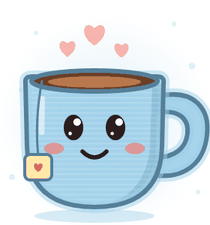

# Mascotes do Painel de Ponto

Mascotes feitos pela comunidade para o Painel de Ponto. Um mascote é só uma pasta com imagens PNG e um
`mascote.json`: não tem código.

Você pode usar um mascote de dois jeitos:

- **Só no seu computador:** no app, abra Configurações › Personagem › **Adicionar mascote…** e escolha o `.zip`
  ou o `mascote.json` de dentro da pasta. Não precisa enviar nada para cá.
- **Para todo mundo:** envie uma PR com a pasta do mascote. Depois de aprovado, ele entra no app numa versão nova.



Acima, o [Tice](mascotes/tice) trocando de pose como faz no app: pisca, fala (alterna `parado.png` e `falando.png`) e muda
de humor. O [Gato laranja](mascotes/gato-laranja) é um exemplo mínimo, só com três imagens.

## Formato (versão 1)

```
mascotes/gato-laranja/
  mascote.json
  parado.png      obrigatória
  falando.png     opcional
  piscando.png    opcional
  feliz.png       opcional
  preocupado.png  opcional
  dormindo.png    opcional
  bravo.png       opcional
```

Quadros extras, também opcionais, deixam a animação mais fluida: `falando-meio.png`, `surpreso.png`, `frente.png`,
`agachada.png`, `pendurada.png`, `espiando.png` e os quadros de dança (veja a tabela e a seção Dança abaixo). O app aceita esses quadros a partir da versão 0.13.0; versões anteriores recusam o pacote que os traz.

`mascote.json`:

```json
{
  "formato": 1,
  "nome": "Gato laranja",
  "autor": "Seu nome ou apelido",
  "licenca": "MIT"
}
```

`"descricao"` (opcional) é a linha embaixo do nome na lista de mascotes do app; sem ela, aparece "De" e o autor.

| Imagem | Quando aparece |
| --- | --- |
| `parado.png` | Sempre que não houver outra pose para o momento |
| `falando.png` | Alterna com `parado.png` enquanto o balão aparece (boca mexendo) |
| `piscando.png` | De vez em quando, por um instante (olhos fechados) |
| `feliz.png` | Almoço, comemoração, água bebida |
| `preocupado.png` | Avisos de atenção, espiando atrás do painel, sendo arrastado |
| `dormindo.png` | Fim do expediente, tontura |
| `bravo.png` | Quando clicam nele muitas vezes seguidas |
| `falando-meio.png` | Boca meio aberta: a fala vira fechada → meio → aberta → meio |
| `surpreso.png` | Avisos de ponto (olhos arregalados) |
| `frente.png` | No meio da virada, quando o humor troca de lado (veja `"esquerda"`) |
| `agachada.png` | Um instante antes do pulinho e ao pousar depois de arrastado |
| `pendurada.png` | Enquanto é arrastado (no lugar de `preocupado.png`) |
| `espiando.png` | Escondido atrás do painel aberto, no lugar de `preocupado.png`: desenhe só a cabeça saindo de trás de uma quina, com tudo à direita da coluna 310 (de 453 px de largura, 68%) vazio. O app não inclina essa pose |

Se faltar uma pose, o app usa `parado.png` no lugar.

### Dança (opcional, app 0.14.0 em diante)

Quadros `danca-1.png` a `danca-8.png` e, no `mascote.json`, a ordem em que tocam e quanto dura cada passo:

```json
"danca": {
  "passos": ["danca-1", "danca-2", "danca-1", "danca-2"],
  "ms": [500, 500, 340, 280]
}
```

- `passos`: de 2 a 32, só quadros `danca-N` que o pacote tem.
- `ms`: um número (o mesmo tempo para todos os passos; a sequência toca duas vezes) ou uma lista com um tempo para cada passo (de 120 a 800 ms; a lista é a dança inteira e toca uma vez). Use a lista para começar devagar e acelerar.
- O mascote dança quando marca a entrada, quando bate a meta da água e, no modo "Agitado", de vez em quando. Nunca atrás do painel aberto.
- Desenhe os quadros do mesmo tamanho e com os pés na mesma linha das outras poses. `danca-1` e `danca-2` ganham um giro leve pelos pés (um para cada lado): um passo e o espelho dele já fazem uma boa dança.
- Versões do app anteriores a 0.14.0 recusam o pacote que traz esses quadros.

### Lados (opcional)

Se algumas poses olham para o outro lado, liste-as em `"esquerda"` no `mascote.json`, ex.:
`"esquerda": ["feliz", "dormindo", "bravo"]`. Com `frente.png`, a troca de lado passa por ela em vez de virar de uma vez.

### Falas (opcional)

O mascote pode ter as próprias falas no `mascote.json`. `{n}` vira o primeiro nome de quem usa o app.

```json
{
  "formato": 1,
  "nome": "Tice",
  "autor": "Painel de Ponto",
  "licenca": "MIT",
  "falas": {
    "feliz": ["Chá quentinho e ponto em dia, {n}!"],
    "pouso": ["Cuidado que eu derramo!"],
    "bravo": ["Ei! Saquinho de chá não é brinquedo, {n}!"]
  }
}
```

| Chave | Quando ele fala |
| --- | --- |
| `feliz` | Clique nele ou fala solta, com tudo em dia |
| `preocupado` | Clique ou fala solta, com pendência no ponto |
| `almoco` | Durante o almoço |
| `dormindo` | Fora do expediente |
| `espiando` | Atrás do painel aberto |
| `pouso` | Logo depois de ser arrastado |
| `tonto` | Depois de alguns cliques seguidos |
| `bravo` | Depois de muitos cliques seguidos |

Cada chave é uma lista (até 20 falas, 140 letras cada); o app sorteia uma. A chave que você não puser usa as falas
padrão. Os avisos do ponto (entrada, almoço, pendências) continuam com o texto do app.

### Regras

- Só PNG, com transparência. Desenhe o personagem **de pé, encostado na base da imagem**: o app alinha a imagem
  pelo chão.
- Todas as poses com o mesmo tamanho. De 16 a 1024 px de cada lado (algo como 200 × 260 fica bom).
- Até 1 MB por imagem e 5 MB no total.
- Na pasta só entram o `mascote.json`, as imagens da tabela e, se quiser, `README.md`, `LICENSE` ou `.txt`.
  Qualquer outro arquivo faz o pacote ser recusado.
- Nada de personagens de outras pessoas ou empresas (desenhos, marcas, personagens famosos), e nada impróprio para
  o trabalho.

## Enviar o seu

1. Faça um fork deste repositório.
2. Crie a pasta `mascotes/<nome-do-mascote>` (minúsculas e hífen) com o `mascote.json` e as imagens.
3. Confira: `node ferramentas/checar.js mascotes/<nome-do-mascote>` (precisa do Node 18 ou mais novo).
4. Abra a PR. A checagem automática roda sozinha; depois, a revisão de uma pessoa decide se ele entra.

A PR deve mexer só na pasta do seu mascote.

## Licença

As ferramentas usam a licença MIT (veja [LICENSE](LICENSE)). Cada mascote usa a licença escrita no próprio
`mascote.json`.
